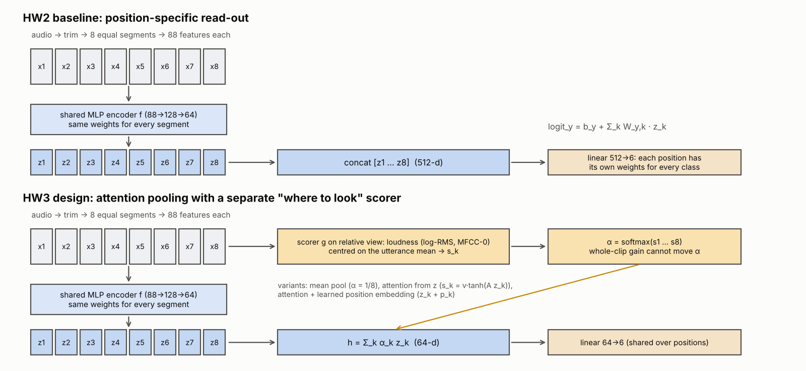
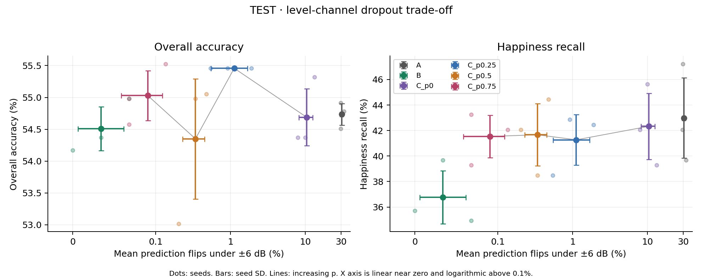
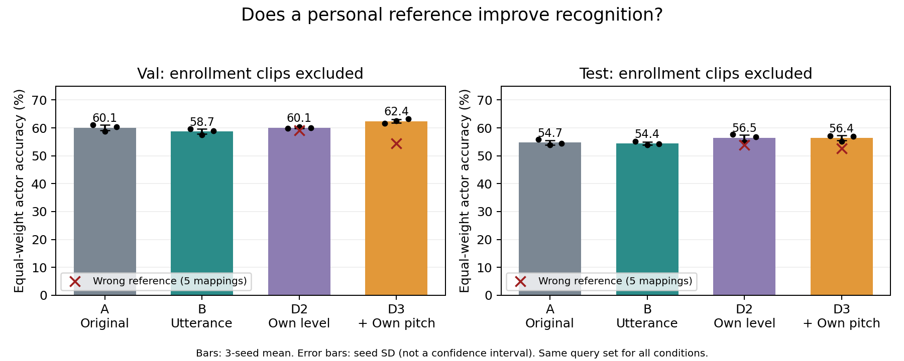

# HW3 — Where should amplitude information enter a speech emotion model?

[中文说明](README_zh.md) · [HW2 repository](https://github.com/Georg11a/deep-learning-assignment2) · [HW2 site](https://georg11a.github.io/deep-learning-assignment2/) · [Data attribution](DATA_ATTRIBUTION.md)

This repository contains the completed HW3 attention/gain experiments **and a separately frozen personal-reference follow-up**. It includes code, feature data, configurations, trained checkpoints, per-example predictions, training histories and figures. Raw WAVs are not bundled. No HTML application is required to run these experiments.

## Task and baseline

Predict six CREMA-D actor-intended emotions (ANG, DIS, FEA, HAP, NEU, SAD) from 7,442 recordings. Each utterance is trimmed and divided into eight segments; each segment has 88 acoustic statistics. A shared 88→128→64 ReLU MLP encodes the segments. Their ordered representations are concatenated and a 512→6 linear head predicts emotion. There is no transcript input.

The speaker-disjoint split has 64 training, 9 validation and 18 test actors (5,235/732/1,475 utterances in the main study). The three training seeds are 7, 11 and 23. All main models use SGD (learning rate .02, momentum .9, weight decay .005), 60 epochs, cosine scheduling, batch size 64 and dropout .5; checkpoints maximize validation accuracy. Feature z-score statistics use training data only.



## Hypotheses and chronology

1. **Initial attention experiment:** adaptive segment pooling might improve emotion classification. A separate relative scorer might reduce gain sensitivity. The scorer receives all 88 features with only MFCC-0 mean and log-RMS mean centered. Attention did not improve accuracy (about 54.7%→51.5%) or solve global gain sensitivity. Position embeddings partially recovered accuracy to 53.1%, without uniquely explaining the loss.
2. **Path diagnostics:** swap clean/perturbed segment representations and attention weights independently. Among global-gain correct→wrong events, representation-only replacement was sufficient in about 83.8%, weight-only replacement in 15.8%. These are potentially overlapping conditional-sufficiency rates, **not additive causal shares**.
3. **Exploratory input intervention B:** center those two columns before the encoder. This greatly reduces gain flips with little observed clean-accuracy cost.
4. **Exploratory channel-use experiment C:** add a separate two-level branch to the position-preserving relative model, dropping its contribution during training with probability p. A protocol was saved before this sweep; p=.75 was selected by mean validation accuracy before the new test scoring. Earlier test inspection had already motivated the study, so it remains exploratory.

## Main results

Means across three seeds. Accuracy uses actor labels on original recordings; gain flip means a model changes its top-1 prediction after −6 or +6 dB, averaged across both directions. It is not an accuracy decrease.

| Model | Test accuracy | Macro-F1 | Mean ±6 dB flip |
|---|---:|---:|---:|
| A: original concatenation | 54.73% | .5420 | 30.69% |
| B: input centering | 54.51% | .5391 | 0.034% |
| C: p=0 | 54.69% | .5435 | 10.40% |
| C: p=.25 | 55.46% | .5498 | 1.12% |
| C: p=.5 | 54.35% | .5398 | 0.34% |
| C: p=.75 (validation selected) | 55.03% | .5457 | 0.09% |

The robust result is decreasing gain sensitivity across the fixed p grid. C is not established as more accurate than B: selected C−B is +.52 percentage points, with a descriptive actor-bootstrap 95% interval [−.52, 1.47]. B has the simpler design and the lower observed gain flip rate. B's current pipeline has three flip events in 8,850 comparisons, so **do not report exact invariance or zero flips**.

At inference, λ=0 removes the C level contribution without retraining. For p=.75, validation accuracy changes from 59.43% to 59.47%. Thus C's differences from independently trained B cannot be assigned simply to using the level branch at inference. This result is not universal: for p=0, removing the branch reduces overall validation accuracy. Happy-class gains were motivated by earlier test inspection and are exploratory; they do not prove that absolute level helps happy recognition. Selected C's happy recall is 62.4% on validation and 41.5% on test.



## Personal-reference follow-up (separate evaluation population)

Question: does a reference from a person's other neutral recordings help identify their emotional performances? See [the protocol and full results](hw3/personal_reference/README.md).

Each actor provides three fixed actor-neutral enrollment clips (DFA, TAI, IOM). They are excluded from every training loss and evaluation. A/B are retrained on the same remaining queries as D2/D3: 5,043/705/1,421 train/validation/test recordings. D2 subtracts personal enrollment means for the two amplitude columns; D3 also centers log-F0 mean. D3 was fixed as primary before training. All models retain the HW2 architecture and parameter count.

| Condition | Equal-weight test actor accuracy | Sample test accuracy | Wrong-reference actor accuracy |
|---|---:|---:|---:|
| A, retrained | 54.75% | 54.75% | — |
| B, retrained | 54.42% | 54.42% | — |
| D2: personal amplitude reference | 56.49% | 56.49% | 53.87% |
| D3: amplitude + pitch reference | 56.41% | 56.42% | 52.64% |

D3−B actor-average accuracy: +1.99 points [0.21, 3.66]. D3 matched−mismatched reference: +3.78 points [2.24, 5.34]. Intervals are descriptive actor bootstrap over 18 test actors. Adding pitch has no established incremental test benefit over D2. Different query/training sets mean these values cannot be subtracted from the earlier main-study table.

In a post-hoc check, the benefit persists on the 1,151 queries whose sentence type differs from that actor's enrollment sentences: D3−B is +2.05 points [0.35, 3.68], D2−B +2.46 [0.50, 4.34]. The other 270 queries share an enrollment sentence type, but not a recording. These are saved-prediction subset analyses, not an independent test or a retraining with held-out wording; see [the full check](hw3/personal_reference/README.md#post-hoc-sentence-overlap-check).

The benefit requires enrollment and does not isolate speaker identity from same-session/channel characteristics. The old test split was previously examined. **D3's neutral→sad rate is 18.43%, exactly the same as A's three-seed aggregate**, versus B's 20.91%; the smaller loudness correlation is a different outcome. There is no claim to have solved speaker variation, demographic fairness or all neutral errors.

D2/D3 gain robustness has not been tested. With a fixed enrollment reference, query-only gain reintroduces the two amplitude-column shifts; personal centering provides no architectural cancellation. Under ideal additive shifts, the same gain applied to both enrollment and query cancels in those columns. Neither observation determines the actual top-1 flip rate or guarantees device robustness. The full README specifies the two future tests without reporting them as completed.

**An earlier claim is withdrawn:** listeners also show a negative association between registration loudness and sadness votes for neutral query clips under the new definition (ρ≈−.61, descriptive 95% interval [−.82, −.24]). The baseline association is also negative (ρ≈−.60). Personal-reference models have smaller point correlations, but this does not establish causal bias removal or a significant difference between correlations. Recording/performance characteristics could contribute to both human and model judgments. See the saved intervals and all per-actor data.



## Reproduce from this repository root

Python 3.9+; the executed environment used Python 3.9.6, PyTorch 2.8.0, NumPy 2.0.2, scikit-learn 1.6.1, librosa .11.0 and SciPy 1.13.1. These CPU runs are small; environments may introduce numerical differences. `requirements-tested.txt` records the tested versions.

```bash
python -m venv .venv
source .venv/bin/activate
python -m pip install -r requirements.txt
python scripts/verify_results.py
```

For the new personal-reference experiment, the bundled feature cache suffices:

```bash
python hw3/personal_reference/run.py --check-only
python hw3/personal_reference/run.py --out hw3/personal_reference/reproduction
python hw3/personal_reference/summarize.py --out hw3/personal_reference/reproduction
python hw3/personal_reference/sentence_overlap_check.py --out hw3/personal_reference/reproduction
```

For the earlier attention variants, use a new run directory to preserve the submitted checkpoints:

```bash
python hw3/train_variants.py --runs-dir hw3/reproduction_runs
```

For the C experiment, waveform perturbation tests also require the original WAVs (~600 MB download). The bundled A/B checkpoints are used as the verified comparison:

```bash
python scripts/download_crema.py
python hw3/level_tradeoff/experiment.py --features data/features_K8.npz --audio data/crema --pilot hw3/runs --out hw3/level_tradeoff/reproduction
python hw3/level_tradeoff/summarize.py --out hw3/level_tradeoff/reproduction --features data/features_K8.npz
```

To regenerate the feature cache, download WAVs first, then run:

```bash
python training/features.py --audio data/crema --out data/features_rebuilt.npz --workers 4
```

The older full local-gain/path-swap analysis can be rerun with `python hw3/perturb_features.py` followed by `python hw3/analysis.py`. **Run those legacy commands in a separate copy:** they overwrite `hw3/results` and use `hw3/runs`. Legacy figures and outputs are historical; prefer the corrected tables and interpretation here. Historical `speaker_norm_check.py` uses all clips per test speaker (transductive); its 62.4% is not the personal-enrollment result.

## Files and evidence

- `training/`: original HW2 feature/model/training code.
- `hw3/models.py`, `train_variants.py`, `analysis.py`: attention variants and path diagnostics. Packaging adds overwrite protection, corrects scorer documentation and uses tied-average Spearman ranks; trained weights are unchanged.
- `hw3/runs/`, `hw3/results/`, `hw3/figures/`: historical pilot artifacts; read `docs/pilot-audit-zh.txt` (Chinese) with them. Its old zero-flip wording is superseded by the main table above.
- `hw3/level_tradeoff/`: exact executed C experiment and pre-run protocol, frozen validation choice, checkpoints, predictions, curves and paired intervals. Duplicate HW2 model/feature modules are retained to preserve source hashes.
- `hw3/personal_reference/`: frozen follow-up protocol, independent enrollment/query manifest, checks, 12 models, complete predictions and results.
- `docs/`: concise experiment narrative and video script. These are editable source drafts, not a rendered page-count-verified PDF or a recorded video.
- `docs/REVIEW_UPDATES_ZH.md` (Chinese): review corrections, the post-hoc check and its provenance. The report/video retain the attention→path swap→B→C main story; personal enrollment is a short extension. The two DFA-neutral demo recordings are enrollment clips and must not be presented as D2/D3 evaluation cases.
- Language: this README, `docs/HW3_REPORT_EN.md`, `docs/VIDEO_SCRIPT_EN.txt` and the experiment READMEs are in English. Files ending in `_zh`/`-zh` or `_ZH` are Chinese working notes and translations. The pre-run protocols (`protocol-zh.txt`) are Chinese originals kept unchanged because their hashes are recorded and verified; their hypotheses are summarised in English above.
- `MANIFEST.sha256`: package integrity hashes. Recorded absolute paths in old configs are execution provenance; pass new CLI paths when reproducing on another machine.

## What was learned and what was not established

Stable attention weights do not guarantee stable predictions. A simple input correction can be more effective than a more elaborate readout. Training a branch and relying on it at inference are different questions. Personal enrollment appears useful in this particular follow-up, but actor/session effects and annotation ambiguity remain.

Centering, attention, channel dropout and speaker adaptation are existing ideas. This coursework contribution is their targeted, controlled application and the resulting failure analysis; no globally novel layer or diagnostic method is claimed. Within these HW3 experiments we did not train on listener soft labels, run RLHF, conduct new listening studies, or test age/sex groups. Two later exploratory studies in `research/` (listener-vote training and an audio-LLM pilot) are described separately below and are not part of the HW3 design. AI assisted implementation, execution and drafting; the student must understand and take responsibility for the design and final interpretation.

## Beyond HW3: exploratory follow-ups (`research/`)

These were run after the HW3 experiments and are **not part of the HW3 design or grading**. Both reuse the HW3 speaker split and enrollment clips; the test speakers had already been used throughout HW3, so every result is exploratory.

- **`research/listener_labels/`** — same D2 input, only the training target changes (actor label, listeners' top vote, full listener vote distribution). Training on the vote distribution brings predictions much closer to listeners (cross-entropy to votes 2.15 → 1.30) but actor accuracy falls from 56.9% to 27.9%, and the model inherits the listeners' tendency to hear quieter speakers' neutral clips as sadder. Protocol frozen before training; see its `README-zh.md` (Chinese).
- **`research/omni_pilot/`** — Qwen2.5-Omni-7B, zero-shot, with short acoustic descriptions computed against different references. Written descriptions raise actor accuracy (37.3% → 46.1%) while moving answers away from listeners; changing only the written loudness from low to high flips 21.8% of answers with identical audio. The personal-reference wording was revised after an exploratory pilot; thresholds come from training speakers only and were fixed before the reported run.

The common lesson across HW3 and these follow-ups: what a cue is compared with, and whose judgement the model should match (the actor's intent or what listeners hear), are design decisions with measurable consequences.

The HW2 web application and its description are in the [HW2 repository](https://github.com/Georg11a/deep-learning-assignment2); `training/` here is the HW2 model code that HW3 builds on.

## Repository

This repository holds HW3 only. Raw CREMA-D audio is not included (see `scripts/download_crema.py` and `DATA_ATTRIBUTION.md`); the feature cache, checkpoints and predictions needed by `scripts/verify_results.py` are.
